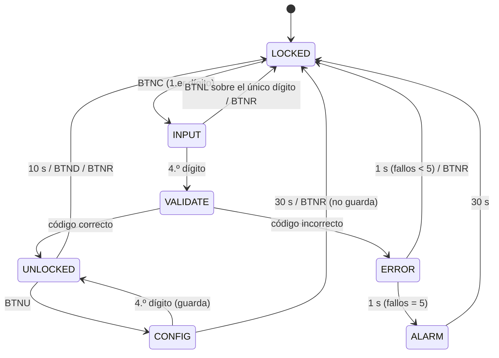

# Candado digital de control de acceso (FSM de Moore) — Nexys4 DDR / Artix-7

Proyecto final de **Electrónica Digital 2026-2** — Universidad San Buenaventura, Bogotá.
Integrantes: Samuel Ibañez, Manuel Betancurt, David A. Cañón M.

Candado de 4 dígitos descrito como **máquina de estados de Moore**. Flujo de trabajo del curso:

```
Python (MyHDL)  ──►  pruebas + modelo de referencia  ──►  VHDL  ──►  GHDL / Vivado (simulación)  ──►  bitstream  ──►  Nexys4 DDR
```

Placa: **Digilent Nexys4 DDR** (FPGA Artix-7 `XC7A100T-1CSG324C`; los pines son los mismos de la Nexys A7-100T).
Sólo usa recursos de la placa: switches, pulsadores, LEDs, display de 7 segmentos, LED RGB, salida de audio
y el puente USB-UART (registro de eventos, opcional).

---

## Guía rápida de uso

Código de fábrica: **1 2 3 4**.

### Abrir el candado

1. El display muestra **`LOCKEd 5`**: el candado está cerrado y le quedan 5 intentos.
2. Ponga el primer dígito en los switches **SW3..SW0** (en binario, 0..F) y pulse **BTNC**.
3. Repita con los otros 3 dígitos. El display muestra **`CodE----`** con un `-` por dígito ingresado
   (el valor no se muestra) y `_` por cada dígito que falta.
4. Al confirmar el 4.º dígito se valida automáticamente:
   * correcto → **`UnLOCKEd`** (LED RGB verde) durante 10 s;
   * incorrecto → **`Error  4`** (le quedan 4 intentos) durante 1 s y vuelve a `LOCKEd 4`.

Ejemplo para 1-2-3-4: `SW=0001` BTNC, `SW=0010` BTNC, `SW=0011` BTNC, `SW=0100` BTNC.

### Botones

| Botón | Función |
|---|---|
| `BTNC` (centro) | confirma el dígito puesto en `SW3..SW0` |
| `BTNL` (izq.) | borra el último dígito (si borra el único, vuelve a `LOCKED`) |
| `BTNR` (der.) | cancelar: borra lo escrito y vuelve a `LOCKED`. **No** devuelve intentos ni apaga la alarma |
| `BTNU` (arriba) | con el candado abierto: **cambiar el código** (entra a `CONFIG`) |
| `BTND` (abajo) | con el candado abierto: **cerrar ya**, sin esperar los 10 s |
| `CPU RESET` (rojo) | reset total: `LOCKED`, 5 intentos, alarma apagada y **código de fábrica 1234** |

### Cambiar el código

1. Abra el candado con el código actual (`UnLOCKEd`).
2. Pulse **BTNU**: el display muestra **`SEt ____`**.
3. Ingrese los 4 dígitos nuevos con `SW3..SW0` + `BTNC`. Aquí **sí** se ven los dígitos
   (`SEt 9C__`) para que pueda revisarlos; `BTNL` borra el último.
4. Al 4.º dígito el código queda guardado y vuelve a `UnLOCKEd`.
   Si pasan 30 s sin terminar, o pulsa `BTNR`, se cierra **sin** cambiar el código.

El código nuevo se conserva hasta pulsar `CPU RESET` o reprogramar la FPGA (no hay memoria no volátil).

### Alarma

Tras **5 intentos fallidos seguidos** se activa la alarma durante **30 s**:

* display **`ALArnn`** parpadeando, los 16 LEDs parpadeando y LED RGB magenta parpadeando;
* **sirena** de dos tonos (1 kHz / 660 Hz) por la salida de audio.

La Nexys4 DDR **no tiene parlante ni zumbador integrado**: tiene un **jack de audio de 3,5 mm** (mono).
Para oír la sirena conecte audífonos o un parlante con amplificador al jack. Opcionalmente puede conectar un
**zumbador piezoeléctrico pasivo** entre el pin **JA1** y **GND** del conector Pmod JA. Sin nada conectado,
la alarma se ve igual en LEDs y display.

Durante la alarma **ningún botón tiene efecto** (ni `BTNR`). Sale sola a los 30 s, con los 5 intentos
restaurados, o con `CPU RESET`. Los intentos fallidos sólo se reinician con un acceso correcto, al terminar
la alarma o con `CPU RESET`.

### Indicadores

| Indicador | Significado |
|---|---|
| Display AN7..AN0 | texto del estado (8 caracteres, ver tabla de estados) |
| `LD3..LD0` | dígitos ingresados (0 a 4 LEDs) |
| `LD8..LD4` | intentos restantes (5 LEDs = 5 intentos) |
| `LD11` | candado cerrado |
| `LD12` / `LD13` / `LD14` / `LD15` | CONFIG / UNLOCKED / ERROR / ALARM |
| LED RGB `LD16` | rojo = cerrado, cian = escribiendo, verde = abierto, amarillo = error, magenta = alarma, blanco = config |
| UART (115200 8N1) | una línea `UNLOCKED 0` por cada cambio de estado (estado + intentos fallidos) |

---

## Máquina de estados (Moore)

| Estado | Display | RGB | Qué hace | Sale a |
|---|---|---|---|---|
| `LOCKED` | `LOCKEd 5` | rojo | cerrado, espera el 1.er dígito | `INPUT` (BTNC) |
| `INPUT` | `CodE--__` | cian | captura los 4 dígitos | `VALIDATE` (4.º dígito), `LOCKED` (BTNL sobre el único dígito o BTNR) |
| `VALIDATE` | — | azul | compara con el código (1 ciclo) | `UNLOCKED` / `ERROR` |
| `UNLOCKED` | `UnLOCKEd` | verde | abierto 10 s | `LOCKED` (tiempo, BTND o BTNR), `CONFIG` (BTNU) |
| `ERROR` | `Error  4` | amarillo | fallo registrado, 1 s | `LOCKED`, o `ALARM` si van 5 fallos |
| `ALARM` | `ALArnn` (parpadea) | magenta | sirena 30 s, ignora botones | `LOCKED` (tiempo o CPU RESET) |
| `CONFIG` | `SEt 9C__` | blanco | captura el código nuevo (máx. 30 s) | `UNLOCKED` (guarda), `LOCKED` (tiempo o BTNR, no guarda) |



`CPU RESET` lleva a `LOCKED` desde cualquier estado. Si se pulsan dos botones a la vez:
`BTNR > BTNL > BTNC` y `BTND > BTNU`. Todos los tiempos están en `src/candado/params.py` (`HW`).

---

## Requisitos

* Python ≥ 3.10, `pip install -r requirements.txt` (MyHDL 0.11.52, pytest)
* GHDL ≥ 4 (opcional, para comprobar el VHDL sin Vivado; el CI de GitHub lo ejecuta)
* Vivado (WebPACK sirve) para sintetizar y programar la Nexys4 DDR

## Comandos

```bash
pip install -r requirements.txt
make all        # regenera VHDL/XDC/vectores, corre pytest y la simulación GHDL
make test       # sólo pruebas Python
make mutation   # prueba de mutación (el probador debe detectar 20/20 fallos inyectados)
make vcd        # build/candado.vcd para GTKWave o https://vc.drom.io
make pyvcd SCEN=tc10_unlocked_vence   # VCD de la simulación Python de un escenario
```

## Poner el diseño en la placa

```bash
vivado -mode batch -source vivado/build_bitstream.tcl   # síntesis + implementación + build/candado_top.bit
vivado -mode batch -source vivado/program_board.tcl     # programa la FPGA (placa por USB)
```

Procedimiento manual equivalente en la interfaz de Vivado:

1. *Create Project* → RTL Project → parte **`xc7a100tcsg324-1`**.
2. *Add Sources*: `hdl/pck_myhdl_011.vhd` y `hdl/candado_top.vhd` (**no** agregue `hdl/modules/`
   ni `candado_top_sim.vhd` a las fuentes de síntesis).
3. *Add Constraints*: `constraints/candado_nexys4ddr.xdc`.
4. *Top* = `candado_top` → *Generate Bitstream* → *Open Hardware Manager* → *Program Device*.

## Estructura

```
src/candado/      diseño en Python/MyHDL (fsm, datapath, inputs, display, status, alarm, uart, top) + modelo de referencia
tests/            pytest: Tabla III del anteproyecto, casos extra, módulos, pines, aleatorio vs modelo, XDC/HDL
tools/            conversión a VHDL, vectores, GHDL, mutación, XDC, VCD
hdl/              VHDL generado (candado_top.vhd = hardware, candado_top_sim.vhd = tiempos reducidos) y por módulo
sim/              testbench VHDL autoverificable + vectores generados desde Python
constraints/      candado_nexys4ddr.xdc (asignación de pines)
vivado/           scripts Tcl
docs/             informe APA 7
```

**No edite `hdl/` a mano:** se regenera con `make hdl`; el CI falla si el VHDL versionado no coincide con el Python.

## Cómo se verifica

1. Pruebas dirigidas: los 10 casos de la Tabla III del anteproyecto + 11 casos extra.
2. Modelo de referencia independiente (nivel de evento) contra el RTL con estímulo aleatorio y rebotes.
3. El VHDL convertido se simula en GHDL con un testbench autoverificable que compara las 39 salidas
   **en cada ciclo** contra la simulación Python (24 escenarios).
4. Prueba de mutación: 20 fallos inyectados, los 20 detectados.
5. El XDC se contrasta con el XDC maestro oficial de Digilent.

## Limitaciones

Maqueta de control lógico, no dispositivo de seguridad: el código no está cifrado, se pierde al reprogramar
y el dígito en curso es visible en los switches. El registro UART es una extensión (el anteproyecto
excluía la comunicación con computador). Para una Nexys4 original (no DDR) los pines son otros.
